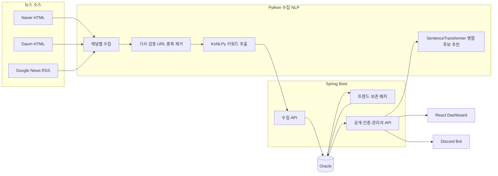

# IT/Tech Trend Analyzer

> 뉴스 수집부터 키워드 추출·중복 제거·24시간 트렌드 집계·근거 기사 탐색까지 연결한 데이터 엔지니어링 포트폴리오입니다.

-6b7280?style=for-the-badge)
[](docs/README.md)

| 바로 보기 | 설명 |
| --- | --- |
| 🌐 운영했던 서비스 (현재 중지) | OCI에 배포해 운영했던 트렌드 대시보드입니다. 현재는 중지 상태이며, 화면은 운영 당시 캡처로 확인할 수 있습니다. |
| [📸 화면별 기능 안내](docs/screens.md) | 인기 키워드, 카테고리, 비교, 기사 탐색, 관리자 구조를 실제 캡처와 번호 설명으로 확인합니다. |
| [🔌 API 구조](docs/api-reference.md) | 화면·수집·인증·관리자 API의 책임과 호출 흐름입니다. |
| [🗃️ Oracle 데이터 모델](docs/data-model.md) | ERD, 테이블 grain(데이터 한 행의 단위), 제약 조건, Flyway 마이그레이션입니다. |
| [✅ 검증 보고서](docs/verification-report.md) | 자동 테스트와 데이터 정확성 검증 범위를 구분해 정리했습니다. |

## 이 프로젝트가 푼 문제

IT 뉴스는 수집원마다 형식이 다르고, 같은 기사나 같은 개념이 중복되어 집계될 수 있습니다. 이 프로젝트는 단순 기사 목록이 아니라 **재현 가능한 트렌드 지표**를 만드는 데 초점을 맞췄습니다.

| 문제 | 설계와 해결 방식 |
| --- | --- |
| 소스마다 HTML·RSS 형식이 다름 | Naver·Daum HTML과 Google News RSS를 하나의 기사 계약으로 정규화합니다. |
| 같은 기사가 여러 번 들어올 수 있음 | `source_url`을 기준으로 저장 단계에서 중복을 막고, 집계는 고유 기사 수를 사용합니다. |
| 인기와 급상승을 혼동하기 쉬움 | 현재 24시간 언급량과 직전 24시간 대비 증감을 분리해 각각 보여 줍니다. |
| AI 병합이 잘못된 분석을 만들 수 있음 | AI는 후보만 추천하고, 관리자 승인 결과만 alias 규칙과 집계에 반영합니다. |
| 숫자만으로 분석 결과를 신뢰하기 어려움 | 키워드 비교에서 날짜별 수치와 실제 기사 근거까지 조회할 수 있습니다. |

## 운영 당시 서비스에서 확인할 수 있던 기능

> 서비스는 OCI에서 운영했으며 현재는 중지 상태입니다. 각 기능은 [화면별 기능 안내](docs/screens.md)의 운영 당시 캡처로 확인할 수 있습니다.

| 기능 | 라이브 화면 | 확인 포인트 |
| --- | --- | --- |
| 인기·급상승 키워드 | 대시보드 | 언급량, 변동성, Hot Score와 순위 기준 전환 |
| 카테고리 분석 | 카테고리 | IT/과학·경제 단위의 키워드 탐색 |
| 키워드 비교 | 비교 | 2~30일 기간 선택, 두 키워드의 시계열·근거 기사 |
| 관련 기사 탐색 | 기사 | 인기 키워드 선택 후 최신 기사와 7일 흐름 확인 |
| 키워드 상세 | 예시 화면 | 선택 키워드의 추이와 기사 탐색 |

관리자 화면은 권한이 필요한 내부 운영 기능입니다. 공개 저장소에는 구조와 설계 의도만 [화면 안내](docs/screens.md#5-관리자-화면-내부-운영-기능)로 제공합니다.

## 시스템 구조



### 데이터 흐름

1. Python 수집기가 기본 3시간 간격으로 세 뉴스 채널을 독립 실행합니다.
2. 본문·발행 시각 검증과 배치 내부 URL 중복 제거를 거칩니다.
3. 채널·카테고리 편중을 줄이는 순환 선택으로 최대 50건을 전송합니다.
4. KoNLPy Okt가 명사 키워드를 추출하고 Spring API에 전달합니다.
5. Spring은 `source_url`을 다시 검증한 뒤 기사·키워드·수집 실행 이력을 Oracle에 저장합니다.
6. 매시간 현재 24시간과 직전 24시간을 비교해 최신 트렌드 스냅샷을 갱신합니다.
7. React는 순위·카테고리·비교·근거 기사·수집 현황을 조회합니다.

## 핵심 데이터 계약과 지표

| 대상 | 데이터 단위(grain) | 정확성 규칙 |
| --- | --- | --- |
| `articles` | 원본 기사 1건 | `source_url` 유일성으로 중복 저장을 방지합니다. |
| `article_keywords` | 기사 × 원본 키워드 | 기사에서 추출한 키워드와 가중치를 보존합니다. |
| `trend_metrics` | 대표 키워드 × 카테고리의 최신 스냅샷 | 현재·직전 24시간의 고유 기사 수를 비교합니다. |
| `crawl_batch_runs` | Python `run_job()` 1회 | UUID·상태 전이·단계별 수량 대사를 기록합니다. |
| `crawl_channel_runs` | 배치 × `naver/daum/rss` | 채널별 성공·빈 결과·부분 실패·실패를 분리합니다. |

```text
mentionCount  = 현재 24시간의 고유 기사 수
velocityScore = 현재 24시간 기사 수 - 직전 24시간 기사 수
hotnessScore  = mentionCount × 0.4 + velocityScore × 0.6
```

- **인기**는 `mentionCount` 중심으로 정렬합니다.
- **급상승**은 양수 `velocityScore` 중심으로 정렬합니다.
- **Hot Score**는 언급량과 증가 속도를 함께 보는 보조 지표입니다.

## 기술 선택

| 영역 | 기술 | 선택 이유 |
| --- | --- | --- |
| 수집·NLP | Python, BeautifulSoup, feedparser, KoNLPy, SentenceTransformer | 소스별 파싱과 한국어 키워드 추출·병합 후보 추천을 단순하게 구성합니다. |
| API·배치 | Java 21, Spring Boot 3, Spring Security, JPA, Flyway | 트랜잭션, 인증, 스케줄 배치, DB 계약 관리를 한 서비스에 집중합니다. |
| 데이터베이스 | Oracle ATP / Oracle Free | OCI 운영 환경과 로컬 재현 환경을 같은 SQL 계열로 유지합니다. |
| 화면 | React 19, Recharts | 트렌드·비교·운영 상태를 탐색 가능한 화면으로 표현합니다. |
| 배포 | Docker Compose, OCIR, OCI VM | 개인 프로젝트 규모에서 재현성과 운영 비용의 균형을 맞춥니다. 배포 워크플로는 비공개 개발 저장소에서 운영했고, 이 저장소에는 코드 품질 검사(Qodana)만 있습니다. |

Kafka·Spark·별도 벡터 DB·마이크로서비스는 현재 데이터량과 OCI 무료 자원에서 얻는 가치보다 운영 복잡도가 커서 도입하지 않았습니다.

## 검증 상태

2026-07-22 기준 로컬 검증 결과입니다. 자동 테스트 통과와 실제 OCI 운영 검증은 구분합니다.

| 검증 | 결과 |
| --- | --- |
| Spring Boot | 70 tests passed |
| React | 13 suites, 51 tests passed, production build 성공 |
| Python | 47 tests passed, `compileall` 성공 |
| 데이터베이스 | Flyway V2~V9, Oracle 제약과 수량 대사 계약 반영 |

검증 방법과 남은 범위는 [검증 보고서](docs/verification-report.md)에서 확인할 수 있습니다.

## 로컬 실행

```bash
cp env.local.example env.local
docker compose -f docker-compose.local.yml --env-file env.local up --build
```

| 서비스 | 주소 |
| --- | --- |
| Frontend | `http://localhost:3000` |
| Backend | `http://localhost:8080` |
| Crawler | `http://localhost:5000` |
| Swagger | `http://localhost:8080/swagger-ui/index.html` |

전체 절차는 [로컬 Docker 실행 가이드](LOCAL_DOCKER.md)를 참고하세요. 실제 비밀값은 저장소에 포함하지 않으며 `env.local.example`의 자리표시자만 제공합니다.

## 문서 탐색

| 문서 | 내용 |
| --- | --- |
| [포트폴리오 상세 보고서](docs/portfolio-report.md) | 문제 정의, 데이터 설계, 코드 흐름, 선택 이유와 한계 |
| [화면 안내](docs/screens.md) | 실제 배포 화면과 기능별 번호 설명 |
| [API 구조](docs/api-reference.md) | 화면·수집·인증·관리자 API의 역할 |
| [데이터베이스 구조](docs/data-model.md) | Oracle ERD, grain, 제약, 마이그레이션 |
| [검증 보고서](docs/verification-report.md) | 자동 테스트, 데이터 계약, 운영 검증 범위 |
| [문서 인덱스](docs/README.md) | 문서별 읽는 순서와 목적 |

## 현재 한계

- 외부 뉴스 사이트의 HTML 변경은 수집 실패를 만들 수 있어 운영 표본 확인이 계속 필요합니다.
- 장기 `RUNNING` 수집 이력 자동 종료와 알림은 아직 없습니다.
- `backendAcknowledgedCount`는 HTTP 정상 응답 수이며 신규 DB 저장 건수와 같지 않습니다.
- SentenceTransformer 모델의 ARM64 메모리·초기 로딩 비용은 추가 측정이 필요합니다.
- Redis 기반 분산 제한은 단일 OCI VM 구성에서 필요성이 낮아 보류했습니다.
- 키워드 병합 추천은 실제 데이터에서 기준점(0.85)을 넘는 후보가 없어 0건이며, 기준 조정은 보류 중입니다.
- Discord 연결 E2E 검증은 완료하지 못했습니다.

## License

개인 학습 및 데이터 엔지니어 포트폴리오 목적의 프로젝트입니다.
