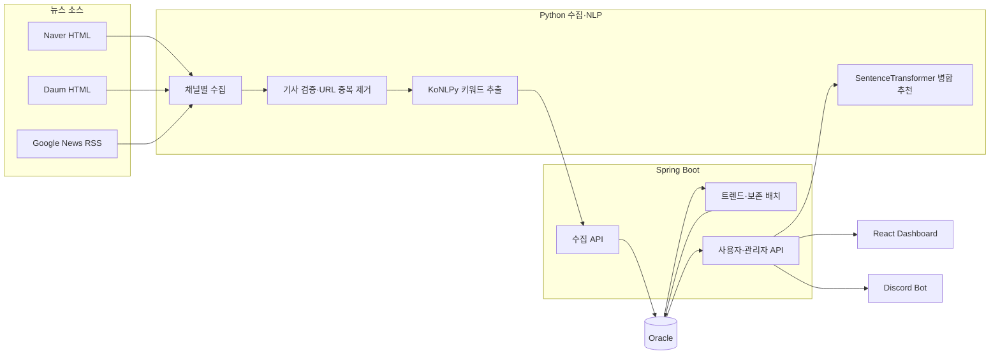

# IT/Tech Trend Analyzer

네이버·다음·Google News RSS에서 IT 뉴스를 수집하고, 기사별 키워드를 추출해 Oracle에 저장한 뒤 최근 언급량과 증가량을 분석하는 데이터 파이프라인 프로젝트입니다.

이 프로젝트는 화면 기능보다 **수집 안정성, 데이터 품질, 재현 가능한 집계, 지표 설명 가능성**을 우선합니다. Python 수집기, Spring Boot API·배치, Oracle, React 대시보드를 하나의 흐름으로 연결하고 OCI 무료 자원에서 운영할 수 있도록 구성했습니다.

## 핵심 성과

- 서로 다른 HTML·RSS 수집원을 하나의 기사 계약으로 정규화했습니다.
- 수집 채널 하나가 실패해도 나머지 채널을 계속 처리하고, 제한 재시도로 일시적 실패를 흡수합니다.
- 배치별 UUID와 단계별 수량 대사를 저장해 누락·중복·부분 실패를 추적할 수 있습니다.
- 같은 기사에서 동일 키워드나 alias가 반복돼도 트렌드 언급량은 기사 1건으로 계산합니다.
- 최근 24시간과 직전 24시간을 겹치지 않게 비교해 인기·급상승 지표를 분리했습니다.
- AI는 키워드를 자동 병합하지 않고 후보만 추천하며, 관리자가 승인한 결과만 집계에 반영합니다.
- 키워드 비교 결과에서 날짜별 수치와 실제 기사 근거까지 내려갈 수 있습니다.

## 시스템 구조



## 데이터 흐름

1. Python 수집기가 기본 3시간 간격으로 네이버·다음·RSS 채널을 독립 실행합니다.
2. 발행 시각과 본문이 없는 기사를 제외하고, 배치 내부 URL 중복을 제거합니다.
3. 채널·카테고리 편중을 줄이는 순환 선택으로 최대 50건을 고릅니다.
4. KoNLPy Okt가 명사 키워드를 추출하고 Spring API에 전송합니다.
5. Spring은 `source_url` 중복을 다시 확인하고 기사·키워드를 Oracle에 저장합니다.
6. 매시간 정각 현재 24시간과 직전 24시간의 고유 기사 수를 비교해 최신 트렌드 스냅샷을 교체합니다.
7. React는 인기·급상승·카테고리·히스토리·근거 기사와 수집 실행 상태를 보여줍니다.

## 핵심 데이터 계약

| 대상 | 데이터 단위(grain) | 정확성 규칙 |
|---|---|---|
| `articles` | 원본 기사 1건 | `source_url` 유일성으로 중복 저장 방지 |
| `article_keywords` | 기사 × 원본 키워드 | 기사에서 추출한 키워드와 가중치 저장 |
| `trend_metrics` | 대표 키워드 × 카테고리 최신 스냅샷 | 현재·직전 24시간의 고유 기사 수 비교 |
| `crawl_batch_runs` | Python `run_job()` 1회 | UUID, 상태 전이, 단계별 수량 대사 |
| `crawl_channel_runs` | 배치 × `naver/daum/rss` | 채널별 성공·빈 결과·부분 실패·실패 구분 |
| 키워드 병합 | 대표 키워드 × alias | 관리자 승인 후에만 집계 반영 |

```text
mentionCount  = 현재 24시간의 고유 기사 수
velocityScore = 현재 24시간 기사 수 - 직전 24시간 기사 수
hotnessScore  = mentionCount × 0.4 + velocityScore × 0.6
```

인기 순위는 `mentionCount`, 급상승 순위는 양수 `velocityScore`를 우선합니다. `hotnessScore`는 두 특성을 함께 보는 보조 지표입니다.

## 기술 스택

| 영역 | 기술 | 선택 이유 |
|---|---|---|
| 수집·NLP | Python, BeautifulSoup, feedparser, KoNLPy, SentenceTransformer | 소스별 파싱과 한국어 키워드 추출을 단순하게 구성 |
| API·배치 | Java 21, Spring Boot 3, Spring Security, JPA, Flyway | 트랜잭션, 인증, 스케줄 배치와 DB 계약 관리 |
| 데이터베이스 | Oracle ATP / Oracle Free | OCI 운영 환경과 로컬 재현 환경을 같은 SQL 계열로 유지 |
| 화면 | React 19, Recharts | 트렌드·비교·운영 상태 시각화 |
| 배포 | Docker Compose, GitHub Actions, OCIR, OCI VM | 개인 프로젝트 규모에서 재현성과 운영 비용의 균형 확보 |

Kafka·Spark·별도 벡터 DB·마이크로서비스는 현재 데이터량과 OCI 무료 자원에서 얻는 가치보다 운영 복잡도가 커서 도입하지 않았습니다.

## 주요 화면과 API

| 기능 | 화면/API |
|---|---|
| 인기·급상승·카테고리 | `/`, `/categories/:categorySlug`, `/api/v1/trends/popular`, `/surging`, `/category` |
| 키워드 상세·기사 | `/keywords/:keyword`, `/api/v1/trends/articles` |
| 2~30일 비교·근거 | `/history`, `/api/v1/trends/history/compare`, `/history/evidence` |
| 수집 실행 관측 | 관리자 수집 현황 탭, `/api/v1/admin/crawling/runs` |
| 사용자·Discord | `/my-info`, `/api/v1/me/**` |
| 키워드 병합 | `/admin`, `/api/v1/admin/keyword-groups`, `/keyword-merge-suggestions` |

화면별 실제 캡처는 [화면 안내](docs/screens.md), 대표 API 계약은 [API 구조](docs/api-reference.md),
Oracle ERD와 데이터 단위는 [데이터베이스 구조](docs/data-model.md)에서 확인할 수 있습니다.

## 검증 상태

2026-07-22 로컬 검증 결과입니다.

| 검증 | 결과 |
|---|---|
| Spring Boot | 70 tests passed |
| React | 13 suites, 51 tests passed, production build 성공 |
| Python | 47 tests passed, compileall 성공 |
| 데이터베이스 | Flyway V2~V8, Oracle 제약과 수량 대사 계약 반영 |

자동 테스트 통과는 실제 외부 뉴스 전체 수집이나 OCI 운영 성공을 보장하지 않습니다. 운영 검증과 데이터 의미 검증은 별도로 구분합니다.

## 실행

```bash
cp env.local.example env.local
docker compose -f docker-compose.local.yml --env-file env.local up --build
```

| 서비스 | 주소 |
|---|---|
| Frontend | `http://localhost:3000` |
| Backend | `http://localhost:8080` |
| Crawler | `http://localhost:5000` |
| Swagger | `http://localhost:8080/swagger-ui/index.html` |

자세한 절차는 [로컬 Docker 실행 가이드](LOCAL_DOCKER.md)를 참고하세요.

## 문서

- [포트폴리오 상세 보고서](docs/portfolio-report.md): 문제, 데이터 설계, 코드 흐름, 선택 이유와 한계
- [검증 보고서](docs/verification-report.md): 자동 테스트, 데이터 계약, 운영 검증 범위
- [문서 분류표](docs/README.md): 공개 문서와 내부 문서의 역할

## 현재 한계

- 외부 뉴스 사이트의 HTML 변경은 수집 실패를 만들 수 있어 운영 표본 확인이 계속 필요합니다.
- 장기 `RUNNING` 수집 이력 자동 종료와 알림은 아직 없습니다.
- `backendAcknowledgedCount`는 HTTP 정상 응답 수이며 신규 DB 저장 건수와 같지 않습니다.
- SentenceTransformer 모델의 ARM64 메모리·초기 로딩 비용은 추가 측정이 필요합니다.
- Redis 기반 분산 제한은 단일 OCI VM 구성에서 필요성이 낮아 보류했습니다.

## License

개인 학습 및 데이터 엔지니어·데이터 분석가 포트폴리오 목적의 프로젝트입니다.
