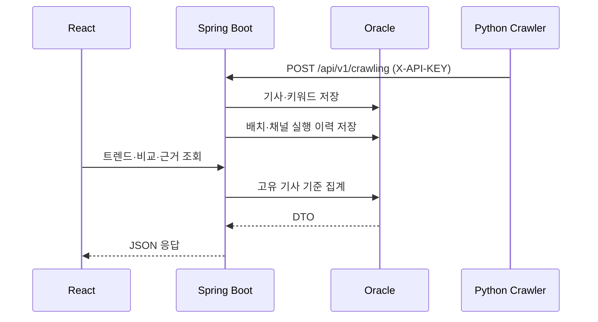

# API 구조

컨트롤러 코드와 실제 화면 호출 경계를 기준으로 대표 API를 정리합니다. 세부 DTO 필드는 코드와 함께 변경될 수 있으므로, 이 문서는 기능·권한·데이터 흐름을 설명하는 포트폴리오용 요약입니다.

## 요청 흐름

## 공개 조회 API

| 기능 | Method | 경로 | 설명 |
|---|---|---|---|
| 전체 트렌드 | GET | `/api/v1/trends` | 기본 트렌드 조회 |
| 인기 키워드 | GET | `/api/v1/trends/popular` | `mentionCount` 중심 순위 |
| 급상승 키워드 | GET | `/api/v1/trends/surging` | 양수 `velocityScore` 중심 순위 |
| 카테고리 목록 | GET | `/api/v1/trends/categories` | 실제 집계 카테고리와 개수 |
| 카테고리 트렌드 | GET | `/api/v1/trends/category` | 카테고리별 키워드 순위 |
| 카테고리 통계 | GET | `/api/v1/trends/stats` | 기사 수·변동성 요약 |
| 관련 기사 | GET | `/api/v1/trends/articles` | 키워드 기준 기사 조회 |
| 키워드 히스토리 | GET | `/api/v1/trends/history` | 단일 키워드 기간별 집계 |
| 키워드 비교 | GET | `/api/v1/trends/history/compare` | 두 키워드 2~30일 비교 |
| 비교 근거 | GET | `/api/v1/trends/history/evidence` | 날짜·키워드별 최신 기사 최대 5건 |

## 수집·실행 이력 API

| 기능 | Method | 경로 | 인증·용도 |
|---|---|---|---|
| 기사 수신 | POST | `/api/v1/crawling` | `X-API-KEY`, Python → Spring |
| 배치 시작 보고 | POST | `/api/v1/crawling/runs` | `run_id`와 `RUNNING` 저장 |
| 배치 완료 보고 | POST | `/api/v1/crawling/runs/completed` | 수량 대사·최종 상태 저장 |
| 실행 목록 | GET | `/api/v1/admin/crawling/runs` | `ROLE_ADMIN`, 최근 실행 |
| 실행 상세 | GET | `/api/v1/admin/crawling/runs/{runId}` | `ROLE_ADMIN`, 채널별 결과 |

## 인증·사용자 API

| 기능 | Method | 경로 |
|---|---|---|
| 현재 사용자 | GET | `/api/v1/auth/me` |
| OAuth 제공자 | GET | `/api/v1/auth/providers` |
| CSRF 토큰 | GET | `/api/v1/auth/csrf` |
| 로그아웃 | POST | `/api/v1/auth/logout` |
| 구독 목록 | GET | `/api/v1/me/subscriptions` |
| 구독 생성 | POST | `/api/v1/me/subscriptions` |
| 구독 삭제 | DELETE | `/api/v1/me/subscriptions/{subscriptionId}` |
| Discord 연결 | GET | `/api/v1/me/discord/link` |
| Discord 연결 해제 | DELETE | `/api/v1/me/discord/link` |

## 관리자·키워드 병합 API

관리자 변경 API는 Spring Security의 `ROLE_ADMIN`과 세션·CSRF 경계를 통과해야 합니다.

| 기능 | Method | 경로 |
|---|---|---|
| 운영 키워드 목록·생성 | GET / POST | `/api/v1/admin/keywords` |
| 운영 키워드 활성/비활성 | PATCH | `/api/v1/admin/keywords/{id}/toggle` |
| 그룹 목록·상세·생성·수정 | GET / POST / PATCH | `/api/v1/admin/keyword-groups` |
| alias 추가·활성·비활성·삭제 | POST / PATCH / DELETE | `/api/v1/admin/keyword-groups/{groupId}/aliases`, `/api/v1/admin/keyword-aliases/{aliasId}` |
| 병합 추천 목록·생성 | GET / POST | `/api/v1/admin/keyword-merge-suggestions` |
| 병합 추천 승인·거절 | PATCH | `/api/v1/admin/keyword-merge-suggestions/{suggestionId}/approve` 또는 `/reject` |
| 수동 트렌드 분석 | POST | `/api/v1/admin/trends/analyze-now` |

## 오류와 데이터 의미

- `400`: 기간·키워드 비교 조건 등 요청 계약 위반
- `401/403`: 로그인 또는 관리자 권한 부족
- `409`: 동일 `run_id`에 다른 payload를 재전송하거나 멱등 계약 충돌
- `backend_acknowledged_count`는 HTTP 정상 응답 수이며 신규 DB 저장 건수가 아닙니다.
