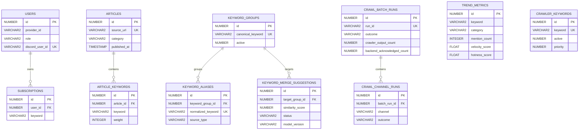

# 데이터베이스 구조

Oracle 기준의 핵심 테이블과 데이터 단위(grain)를 설명합니다. 스키마 변경은 Flyway V2~V9로 관리합니다.

## ERD



## 테이블별 grain과 제약

| 테이블 | 한 행의 의미 | 핵심 제약·역할 |
|---|---|---|
| `articles` | 원본 기사 1건 | `source_url` unique, 중복 저장 방지 |
| `article_keywords` | 기사에서 추출한 원본 키워드 1개 | `article_id` FK |
| `trend_metrics` | 대표 키워드 × 카테고리 최신 스냅샷 | `(keyword, category)` unique |
| `users` | OAuth 사용자 1명 | provider 계정·Discord 식별 |
| `subscriptions` | 사용자 × 구독 키워드 | `users` FK |
| `crawler_keywords` | 운영자가 추적·차단하는 키워드 | `active`, `priority` |
| `keyword_groups` | 대표 키워드 1개 | 정규화 대표어 unique |
| `keyword_aliases` | 원본 표현 → 대표 키워드 | 정규화 alias 전역 unique |
| `keyword_merge_suggestions` | 모델 추천 후보 1건 | 원본·대상 그룹·모델 버전 unique |
| `crawl_batch_runs` | Python `run_job()` 1회 | 상태·시간·수량 대사 check |
| `crawl_channel_runs` | 배치 × `naver/daum/rss` | 채널·상태 check, batch FK |

## 집계 정확성 규칙

```text
crawler_output_count
  = validation_rejected_count + duplicate_url_count + eligible_count

eligible_count
  = selected_count + dropped_by_limit_count

selected_count
  = preprocessing_failed_count + backend_acknowledged_count
  + http_failed_count + transport_failed_count
```

트렌드 집계는 `article_id × 대표 키워드 × 카테고리 × 시간 구간`을 한 번만 계산합니다. 현재 24시간과 직전 24시간은 겹치지 않는 반개구간으로 비교합니다.

## 마이그레이션

- V2: 기사·키워드·트렌드·사용자·구독 기본 구조
- V4~V5: 운영 키워드와 유형 확장
- V6: 대표 키워드·alias·AI 추천 후보
- V7: `trend_metrics` grain unique 제약
- V8: 배치·채널 실행 이력과 수량 대사 제약
- V9: 키워드 병합 추천 실행 이력
