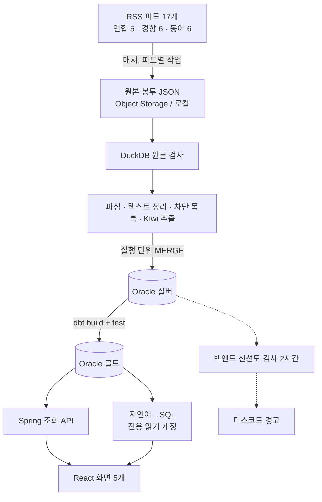

# Trend Analyzer v2 설계 문서

**TL;DR:** 언론사 RSS 17개 → 1시간 DAG(수집 → 원본 → 처리 → MERGE → dbt) → Spring 조회 API → React 5개 화면. 멱등성·재처리·품질을 설계와 테스트로 보장하고, 모든 값에 근거를 단다.
👉 지금 할 것: §11 "새로 정한 부분" 3개와 §12 열린 항목 확인

> 결정 근거는 결정 노트에 있음. 이 문서는 "무엇을 만드는가"만. 각 절 끝 `근거:` 링크 참고.

---

## 1. 목표와 성공 기준

**목표**
- 면접 질문 2개에 화면·코드·테스트로 답함: "스코어 의미", "멱등성"
- DE 파이프라인 신호: 오케스트레이션 · 원본 저장 · 재처리 · 품질 검사 · dbt
- 모든 설정값에 근거 종류 + 바꾸는 기준

**성공 기준**
- [ ] 1시간 DAG가 OCI(또는 로컬)에서 7일 이상 연속 실행, 기록이 파이프라인 현황 화면에 보임
- [ ] 멱등성 테스트 3개 + 중복 검사 SQL 0건이 CI에서 통과
- [ ] 30일 백필 1회 실행 → 규칙 버전 전환 성공 기록
- [ ] 키워드 상세 화면에서 "점수 근거 펼치기"로 lift 계산이 보임
- [ ] 저장소 `docs/decisions.md`에 값별 근거 블록 완성, 측정 기록 채움

근거: [[01_근거 규칙]]

## 2. 범위

**포함:** 수집 재설계 · 원본 저장 · Airflow DAG · Oracle 실버 · dbt 골드 · Spring 조회 API · 신선도 검사 · 자연어→SQL · React 화면 5개 · 테스트 3단 · 로컬 compose · OCI 배포

**제외:** 이터널리턴(별도 프로젝트) · Kafka · Flink · Spark · Iceberg · Terraform · Streamlit · 기사 요약 LLM · 시각 디자인 확정(구현 때 시안) · 비용 상한 숫자(실측 후)

**v1 데이터:** 이관 안 함. v1 원천(네이버 HTML·Google News RSS)이 허용 범위 밖 + 30일 보관이라 자연 소멸

## 3. 전체 구조



| 구성 요소 | 역할 | 실행 |
|---|---|---|
| Airflow 3.3.0 | DAG 3개 (§6) | 서버 상주 |
| 파이프라인 Python 패키지 | 수집·봉투·검사·파싱·추출·적재 | Airflow 작업 안 |
| dbt-oracle 1.12 | 골드 모델·테스트 | Airflow 작업 안 |
| Oracle (로컬 Free 23 / 운영 ATP) | 실버·골드·운영 테이블 | 서버 밖(운영) |
| Spring Boot | 조회 API · 신선도 · 자연어→SQL · 관리자 | 서버 상주 |
| React | 화면 5개 | nginx 정적 |

## 4. 수집

- 원천: 연합·경향·동아 RSS (허용 문구 확인) — 피드 목록은 설정 파일 `feeds.yml`

```text
정치    yna politics      · khan politic_news · donga politics
경제    yna economy       · khan economy_news · donga economy
사회    yna society       · khan society_news · donga national
세계    yna international · khan kh_world     · donga international
문화    yna culture       · khan culture_news · donga culture
IT/과학  —                 · khan science_news · donga science
```
- 주기: 1시간. 조건부 요청(ETag·Last-Modified)
- 재시도: HTTP 최대 3번(2초 → 4초, Retry-After 최대 60초), 대상 = 연결 오류·408·429·5xx. Airflow 작업 재시도 1번(5분), 제한 10분
- 백필 실행에서는 요청 안 함 (원본 존재만 확인)
- 정기·수동 실행은 구간 끝이 지금 − 1시간 ~ 지금 + 5분일 때만 요청. 지난 구간은 백필로만 (✅ 2026-11-05. 지금 피드가 옛 구간 원본으로 굳는 것 방지. 1시간은 임시값, 검사는 수집 함수 안)

근거: [[04_수집]]

## 5. 원본 저장

- 봉투 JSON 1개 = 피드 1회 요청: 요청(URL·시각·크롤러 버전) · 응답(HTTP 상태·ETag·Last-Modified·Content-Type) · 받은 바이트(base64) · 그 바이트의 sha256 · `envelope_version`
- 봉투 v2 (✅ 2026-11-05): 글자 디코드는 처리 단계가 원본을 읽을 때(Content-Type charset, 없으면 UTF-8). 읽을 때 sha256 대조, 다르면 그 피드 실패. v1(디코드한 글자 저장)도 읽음
- 200·304 저장, 실패는 실행 기록만
- 키: `raw/dt=YYYY-MM-DD/source={yna|khan|donga}/feed={섹션}/run=YYYYMMDDTHHMMSSZ.json` (구간 끝, UTC)
- 쓰기: 로컬 임시 파일 → DuckDB 검사 → 조건부 업로드(이미 있으면 실패) → checksum 대조
- 있으면 수집 건너뜀 (수집은 한 번, 처리는 여러 번)
- `RAW_STORAGE=local|oci`
- 보관 30일 (설정 하나, 실버·골드와 공유)

근거: [[05_원본 저장]]

## 6. Airflow DAG

### 6-1. `trend_pipeline_hourly` (매시, catchup 없음, `max_active_runs=1`)
```text
① fetch_feed  [피드 17개로 동적 매핑]
     백필 → 원본 존재만 확인 / 평소 → 없으면 수집·검사·업로드
  ↓ (all_done)
② record_runs   실행·피드별 결과 기록 (4단계 상태)
  ↓
③ load_silver   이 구간 원본 읽기 → 파싱 → 텍스트 정리 → 차단 목록 제외
                → 기사 MERGE → 활성(+빌드 중) 규칙 버전으로 키워드 추출
                → (기사, 버전) 단위 지우고 다시 쓰기       [한 트랜잭션]
  ↓
④ dbt_build     골드 incremental: 구간 끝 ∈ [이름표 − 6시간, 이름표], dbt test
```
- 실행 ID = 구간 끝에서 결정적으로 생성 (`uuid5(DAG id + data_interval_end)`)
- 재처리 = 이 DAG의 백필

### 6-2. `trend_retention_daily` (03:30 KST)
- 기준 = 이름표 − 30일. 원본(dt 경로) · 실버 · 골드 · 실행 기록 삭제

### 6-3. `trend_rule_switch` (수동)
- 입력: 새 규칙 버전 → 30일 백필 완료 확인 → 품질 검사 → 활성 버전 전환 → 옛 버전 행 삭제 → 골드 전체 재계산

근거: [[06_처리와 적재]] 4-4 · [[03_서버와 운영]] 결정 21 · [[규칙 버전]]

## 7. 데이터 모델

### 7-1. 실버·운영 (Flyway 새 마이그레이션)
| 테이블 | 핵심 열 | 키·제약 |
|---|---|---|
| `articles` (변경) | source · source_article_id · title · summary · source_url(정리) · published_at · first_seen_run_end | `UNIQUE(source, source_article_id)` |
| `news_article_categories` 기사-카테고리 (✅ 2026-11-05 추가 결정) | article_id · category | `PK(article_id, category)`. 다대다: 두 섹션에 실린 기사는 두 카테고리 모두. `category` 열 대체. 없으면 넣기만(지우지 않음) → 본 섹션의 합집합이라 처리 순서와 무관. 골드 구간 배정은 `published_at`, `first_seen_run_end`는 기록용 ([[06_처리와 적재]] "계획 2 앞두고 정한 것") |
| `article_keywords` (변경) | article_id · keyword · rule_version | `PK(article_id, keyword, rule_version)` |
| `keyword_rule_versions` (새) | rule_version · rule_json · status(BUILDING·ACTIVE·RETIRED) · created_at | ACTIVE는 1개 |
| `crawl_batch_runs` (변경) | run_id(결정적) · outcome 4단계 · 건수 대조 | 대조 식을 v2 흐름으로 다시 정의: 피드 항목 수 = 새 기사 + 이미 있음 + 제외(공지·차단) + 파싱 실패. v1의 선택·한도·전송 건수 열은 삭제 |
| `crawl_feed_runs` (새, `crawl_channel_runs` 대체) | run_id · source · feed · http_status · item_count · new_article_count · raw_key · fetched_at | `UNIQUE(run_id, source, feed)` |
| `article_blocklist` (새) | source · source_article_id · requested_at · reason · requester_type | `PK(source, source_article_id)` |
| `nlq_cache` · `nlq_usage` (새) | 정규화 질문 · 프롬프트 버전 · SQL / 사용자 · 날짜 · 횟수 | |

- 삭제: `trend_metrics`(골드로 대체), `article_keywords.weight`(빈도 가중 폐기)
- 유지: 사용자·구독·디스코드 연동·키워드 그룹/별칭·병합 추천·`crawler_keywords`

### 7-2. 골드 (dbt)
```text
stg_articles · stg_article_keywords (활성 버전만)
  ↓
int_keyword_canonical   별칭 → 대표 키워드, 차단 키워드 제외
int_feed_coverage       (매체, 카테고리, 구간) 커버 여부: 성공 간격 ≤ 2시간
  ↓
fct_keyword_window      구간 끝 · 카테고리 · 키워드 · 규칙 버전
                        현재·이전 건수 · 다룬 매체 수 · 매체별 비중 · lift
                        · 제외 매체 · is_final
fct_keyword_cooccur     함께 늘어난 키워드 쌍
fct_keyword_daily · fct_category_daily   30일 이력
  ↓
v_nlq_* 뷰 4개          자연어→SQL 전용
```
- lift = 두 구간 모두 커버된 매체의 평균 비중 비율, 비중 = (c + 1) / (N + 1)
- 급상승 = lift > 1 · 현재 3건 이상 · 매체 2곳 이상
- dbt test: unique(키) · not_null · accepted_values(카테고리 6개·매체 3곳) · relationships · lift 재계산 일치 · 급상승 조건 위반 0

근거: [[07_점수와 집계]] · [[급상승 점수]]

## 8. 처리 규칙 (규칙 파일 → 규칙 버전)

```text
입력 = 제목
  ↓ 텍스트 정리
    [속보]·[단독]·[영상]·[포토뉴스]·[쇼츠]·[특징주] → 표시 제거
    [게시판]·[부고]·[인사] → 기사 집계 제외
    그 밖 머리말 → 괄호만 제거
  ↓ 한자 약칭 사전 (中企 → 중소기업 먼저, 美 → 미국 …)
  ↓ Kiwi 품사: NNG · NNP · SL · SH (의존명사·숫자 제외)
  ↓ 2글자 이상 · 불용어 제외
  ↓ 기사당 명사 집합 (상한 없음)
```
- 규칙 버전 = 규칙 파일 해시 앞 8자리
- 요약의 "(지역=매체) 기자명 기자 =" 제거는 저장 전 정리 (화면 표시용)
- 불용어: Kiwi 적용 후 6개 중 5개 카테고리 이상에서 고른 명사 → 검토 → 확정

근거: [[06_처리와 적재]]

## 9. 백엔드 (Spring)

- **빼는 것:** 수집 수신 API(`/crawling`) · `TrendAnalysticService` 스케줄러 · `/analyze-now` · `DataRetentionCleanupService`
- **조회 API:** 인기·급상승(카테고리별) · 키워드 상세(24시간 추이·30일 이력·매체별 대표 기사·함께 늘어난 키워드·점수 근거) · 파이프라인 현황(피드별 마지막 수집·최근 실행·dbt test 결과·원본 용량)
- **신선도 검사:** 정기 작업 → 피드별 마지막 성공 수집 > 2시간이면 디스코드 경고
- **자연어→SQL:** Claude Opus 5.5 · 구조화 출력 `{sql, refused, reason}` · `fallbacks: "default"` · 프롬프트 캐싱 · SELECT 1문 검사 → 전용 읽기 계정 · 뷰 4개 · 제한 시간 · 최대 200행 · 결과는 LLM에 안 넣음 · 예시 질문은 평가셋 정답 SQL 재사용 · 같은 질문 캐시
- **관리자:** 차단 목록 등록 추가 (등록 → 실버·골드 삭제 → dbt 재계산 요청)
- **쓰기 금지 원칙:** 기사·키워드·골드 쓰기는 파이프라인만

근거: [[02_기술 스택]] · [[03_서버와 운영]] 결정 19

## 10. 화면 (React)

① 홈 · ② 키워드 상세(점수 근거 펼치기) · ③ 질문하기 · ④ 파이프라인 현황 · ⑤ 기사·내 정보·관리자 유지
- 빼는 것: 핫스코어·강조도 점수·변동성 패널·규칙형 챗봇
- 기사 표시마다 매체명 + 원문 링크
- 시각 디자인: 구현 때 시안 2~3개 → 선택

근거: [[09_화면]]

## 11. 새로 정한 부분 (✅ 2026-11-04 승인)

1. **키워드 별칭·차단은 골드(dbt)에서 적용.** 실버에는 추출 결과 그대로. 관리자가 별칭을 바꾸면 규칙 버전·백필 없이 dbt 30일 재계산만. 이유: 관리자 사전은 자주 바뀌고 과거에도 즉시 적용돼야 함
2. **DAG 3개:** 매시 파이프라인 + 매일 보관 정리 + 수동 규칙 전환. 이유: 주기가 다른 작업은 DAG를 나눔(결정 4-4의 바꾸는 기준)
3. **유지하는 v1 기능:** 사용자·구독·디스코드 연동·키워드 그룹/별칭·병합 추천(SentenceTransformer)·`crawler_keywords`. 데이터 출처만 골드로 바꿈. `crawler_keywords`의 TRACKING은 v1에서도 수집에 안 쓰였음 → 그대로

## 12. 열린 항목

- [x] **구현 저장소:** 공개 `trend-analyzer-portfolio`에서 단계별 브랜치 + PR. 시작 전 `main`에 `v1-final` 태그. 비공개 `Crawling_Project`는 v1 이력 보관. 비밀 값은 `.gitignore` · GitHub Secrets · 환경 변수, push protection 확인 (태그·브랜치·커밋·푸시는 사용자가 말할 때만)
- [ ] 비용 상한: 평가셋으로 1회 비용 실측 → 사용자 결정
- [ ] +1 보정·급상승 최소 건수: 수집 1주 뒤 비교 확정
- [x] Kiwi vs Okt 비교 측정 (구현 첫 단계, 기록용) → Kiwi 유지 확정 (2026-11-05, [[측정 기록]] M10)
- [x] 불용어 후보 추출 → 검토 → 7개 확정 (2026-11-05, [[측정 기록]] M11). 규칙 파일 반영 = 계획 2 규칙 전환 DAG의 첫 실사례
- [ ] 나머지 언론사 5곳 이용 조건 확인 (추가 여부)
- [ ] OCI 콘솔: VM 사양·ATP 생존 확인 (켜기 전)

## 13. 테스트

- ① 단위: 봉투·파싱·기사 번호·텍스트 정리·한자 사전·규칙 해시·원본 키 (고정 샘플 `샘플_피드_2026-11-04/`)
- ② DB 통합(Testcontainers + Oracle Free 23): 같은 실행 두 번 · 동시 실행 · 중간 실패 후 재실행 · 중복 SQL 0 · 차단 목록 재처리 · 규칙 전환
- ③ 끝까지: 백필 모드 DAG(네트워크 없음) + `dbt build` · 자연어→SQL 평가셋(수동, 변경 시)
- CI: GitHub Actions (①②③, 평가셋 제외)

근거: [[08_테스트]]

## 14. 배포

- 로컬: docker compose (Airflow · Oracle Free 23 · Spring · nginx) — 개발·테스트·견적 측정
- 운영: OCI A1 1대 + ATP + Object Storage (견적 80% 통과 시). dbt는 ATP wallet용 `profiles.yml` 직접 작성
- 초기화 스크립트(cloud-init) + 재구성 절차 문서

근거: [[03_서버와 운영]]

## 15. 구현 순서 (계획 문서에서 상세화)

1. 수집·원본 (피드 설정·봉투·키·DuckDB 검사·로컬 저장) + 단위 테스트
2. 처리·적재 (파싱·정리·Kiwi·MERGE·규칙 버전) + DB 통합 테스트
3. dbt 골드 + dbt test
4. Airflow DAG 3개 + 끝까지 테스트
5. 백엔드 API·신선도·관리자 변경
6. 화면 5개 (시안 → 구현)
7. 자연어→SQL + 평가셋
8. 측정 (견적·Kiwi·불용어·지연) → OCI 배포 → 7일 운영 → 1주 뒤 값 확정
9. `docs/decisions.md` · 면접 노트 마무리
