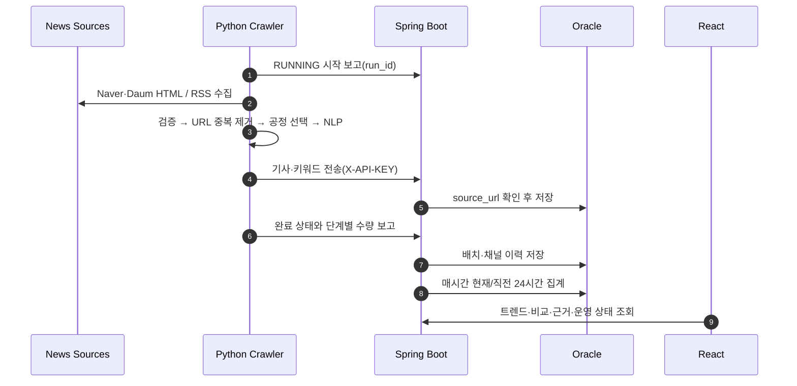
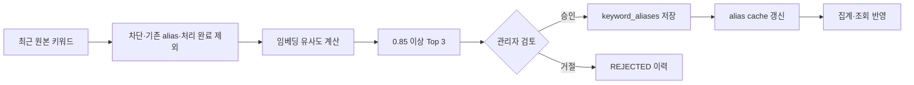

# IT/Tech Trend Analyzer 포트폴리오 보고서

## 1. 문제 정의

IT 뉴스는 여러 매체에 흩어져 있고 같은 개념도 `AI`, `인공지능`, `Artificial Intelligence`처럼 다르게 표현됩니다. 단순 단어 빈도는 한 기사의 반복 표현을 과대평가하고, 수집 채널 일부가 실패하면 결과가 조용히 줄어들 수 있습니다.

이 프로젝트는 다음 질문에 답하도록 설계했습니다.

1. 여러 뉴스 소스를 안정적으로 수집했는가?
2. 저장한 데이터의 누락·중복·실패를 설명할 수 있는가?
3. 트렌드 지표의 데이터 단위와 시간 구간이 명확한가?
4. 집계 결과를 실제 기사 근거까지 추적할 수 있는가?

## 2. 현재 코드 흐름



### Python이 직접 구현한 부분

- 네이버·다음 HTML과 Google News RSS 어댑터
- 채널·카테고리 단위 실패 격리와 제한 재시도
- 발행 시각·본문 필수 검증
- 배치 URL 중복 제거와 채널 편중 완화 선택
- KoNLPy 키워드 추출
- 실행 UUID, 시작·완료 보고, 수량 대사 payload 생성
- SentenceTransformer 기반 키워드 병합 후보 추천

### Spring이 제공하고 프로젝트가 구성한 부분

- Spring Security 필터 체인, OAuth2/OIDC, 세션, CSRF
- JPA 트랜잭션과 Oracle 저장
- `@Scheduled` 기반 시간별 트렌드 분석과 보존 정리
- Flyway V2~V9 스키마 버전 관리
- Micrometer 기반 배치 메트릭

프레임워크가 스케줄 호출과 트랜잭션 경계를 제공하지만, 시간 구간·중복 제거·수량 대사·지표 계산 규칙은 프로젝트가 직접 구현했습니다.

## 3. 수집 신뢰성

### 문제

수집 결과가 0건일 때 실제 뉴스가 없었던 것인지, HTML 구조 변경이나 네트워크 오류로 수집하지 못한 것인지 구분하기 어려웠습니다.

### 변경

- 각 `run_job()`에 UUID `run_id`를 부여했습니다.
- 상태를 `RUNNING → SUCCESS | EMPTY | PARTIAL_FAILURE | FAILURE`로 기록합니다.
- 배치 전체와 `naver/daum/rss` 채널별 결과를 분리해 저장합니다.
- 동일한 `run_id`와 payload 재전송은 멱등하게 처리하고 다른 payload는 409로 거부합니다.
- 수집 출력부터 백엔드 정상 응답까지 다음 수량 관계를 저장합니다.

```text
crawler_output_count
  = validation_rejected_count + duplicate_url_count + eligible_count

eligible_count
  = selected_count + dropped_by_limit_count

selected_count
  = preprocessing_failed_count + backend_acknowledged_count
  + http_failed_count + transport_failed_count
```

### 효과와 해석 한계

어느 단계에서 데이터가 줄었는지 재현할 수 있지만, `backend_acknowledged_count`는 HTTP 정상 응답 수입니다. 이미 존재한 기사도 정상 응답을 받을 수 있으므로 신규 DB 저장 건수로 해석하지 않습니다.

## 4. 데이터 모델과 grain

grain은 “테이블의 한 행이 무엇을 의미하는가”입니다. 집계 정확성은 이 단위를 먼저 고정해야 설명할 수 있습니다.

| 테이블 | 한 행의 의미 | 주요 제약 |
|---|---|---|
| `articles` | 원본 기사 1건 | `source_url` unique |
| `article_keywords` | 기사에서 추출한 원본 키워드 1개 | 기사 FK |
| `trend_metrics` | 대표 키워드 × 카테고리의 최신 스냅샷 | `(keyword, category)` unique |
| `users` | OAuth 사용자 1명 | provider 계정 식별 |
| `subscriptions` | 사용자 × 구독 키워드 | 사용자 FK |
| `crawler_keywords` | 관리자가 추적·차단하는 키워드 | 상태·유형 |
| `keyword_groups` | 대표 키워드 1개 | 정규화 대표어 unique |
| `keyword_aliases` | 원본 표현 → 대표 키워드 | 정규화 alias unique |
| `keyword_merge_suggestions` | 모델 추천 후보 1건 | 상태·모델 버전·처리자 |
| `crawl_batch_runs` | 수집 배치 1회 | `run_id` unique, 수량 check |
| `crawl_channel_runs` | 배치 × 채널 | 채널·상태 check |

초기 설계의 PostgreSQL `BIGSERIAL` 문서는 사용하지 않습니다. 현재 기준은 Oracle `NUMBER`, sequence, Flyway V2~V9입니다.

## 5. 트렌드 지표

### 최신 스냅샷

실행 시각을 기준으로 겹치지 않는 두 구간을 비교합니다.

```text
현재 구간 = [now - 24h, now)
직전 구간 = [now - 48h, now - 24h)
```

한 기사 안에 같은 대표 키워드의 원본 표현이 여러 번 등장해도 `article_id × 대표 키워드 × 카테고리 × 구간`을 한 번만 셉니다.

```text
mentionCount  = 현재 구간의 고유 기사 수
velocityScore = 현재 구간 기사 수 - 직전 구간 기사 수
hotnessScore  = mentionCount × 0.4 + velocityScore × 0.6
```

- 인기: `mentionCount` 우선
- 급상승: 양수 `velocityScore` 우선
- 종합 조회: `hotnessScore` 활용

`trend_metrics`는 원본 데이터가 아니라 매시간 다시 만들 수 있는 최신 스냅샷입니다. 현재·직전 구간 모두에서 사라진 키워드는 남기지 않습니다.

### 일별 히스토리와 비교

- 기간: 2~30일
- 시간대: `Asia/Seoul`
- 날짜 구간: `[00:00, 다음 날 00:00)`
- 오늘: 현재 시각까지의 부분 집계로 표시
- 기본 지표: 고유 기사 수 `articleCount`
- 반복 언급 보조 지표: 기사당 1.2 미만으로 수렴하는 `weightedScore`
- 비교 요약의 우세일·최근 변화: 완료된 날짜만 사용
- 근거 기사: 선택 날짜·키워드별 최신 5건까지 제공

화면의 핵심 KPI에는 이해하기 쉬운 기사 수를 사용하고 `weightedScore`는 기본 순위를 대체하지 않습니다.

## 6. 키워드 병합: Human-in-the-loop

동의어를 그대로 두면 동일 개념이 여러 순위로 나뉘고, 모델이 자동 병합하면 잘못된 추천이 분석 결과를 오염시킬 수 있습니다.



상시 실행되는 별도 AI 서비스나 외부 유료 API 대신, 관리자 요청 시 기존 Python 컨테이너의 로컬 모델을 사용합니다. 이는 OCI 무료 자원의 비용과 운영 복잡도를 줄이기 위한 선택입니다.

## 7. 사용자·관리자 기능

- 공개: 인기, 급상승, 카테고리, 키워드 상세, 기사, 히스토리 비교
- 로그인 사용자: 내 정보, Discord 계정 연결, 구독 생성·조회·해제
- 관리자: 추적·차단 키워드, 키워드 그룹·alias, AI 추천 승인·거절, 수집 실행 현황
- 내부 수집 API: `X-API-KEY`
- 변경 요청: 세션 인증과 CSRF 토큰
- 관리자 API: `ROLE_ADMIN`

프론트엔드의 관리자 라우트는 사용자 경험을 위한 1차 가드이고, 실제 권한 검사는 Spring Security가 수행합니다.

## 8. 배포 구조와 선택 이유

GitHub Actions는 코드 경로가 바뀐 PR과 `main` push에서 품질 게이트를 실행합니다. 운영 배포는 ARM64 Docker 이미지를 OCIR에 저장하고 OCI VM이 Compose로 pull하는 구조입니다. 백엔드·크롤러·프론트엔드는 VM의 loopback 주소에만 바인딩하고 외부 진입은 프록시 계층이 담당합니다.

현재 규모에서 선택하지 않은 방법:

| 대안 | 보류 이유 |
|---|---|
| Kafka·Spark | 수집량 대비 상시 자원·운영 복잡도가 큼 |
| 마이크로서비스 분리 | 한 VM에서 장애 지점과 배포 복잡도만 늘어남 |
| Redis 분산 rate limit | 단일 인스턴스에서는 메모리 방식으로 충분 |
| 외부 LLM 자동 요약 | 비용·지연·설명 가능성보다 우선순위가 낮음 |
| 벡터 DB | 키워드 후보 수와 검색 요구가 작아 인메모리 계산 가능 |

## 9. 변경 전후

| 영역 | 변경 전 | 변경 후 |
|---|---|---|
| 수집 실패 | 전체 0건 또는 로그만 확인 | 배치·채널 상태와 단계별 수량 저장 |
| URL 편중 | 앞선 채널이 최대 건수를 점유 | 채널·카테고리 순환 선택 |
| 트렌드 언급량 | 단어 반복·alias 중복 가능 | 고유 기사 기준 대표 키워드 집계 |
| 증가량 | 이전 저장 스냅샷 의존 가능 | 겹치지 않는 실제 24시간 구간 비교 |
| 키워드 비교 | 차트 수치를 직접 해석 | 요약 KPI·수치표·날짜별 근거 기사 |
| 동의어 처리 | 같은 개념이 분산 | 관리자 승인 alias만 반영 |

## 10. 현재 한계와 다음 우선순위

필수 개선:

- OCI의 실제 배치 수량과 DB 저장 결과를 정기 표본 대사
- 장기 `RUNNING` 자동 실패 전환 또는 알림
- Discord 명령과 웹 구독의 운영 E2E 검증

선택 개선:

- ARM64 SentenceTransformer cold start·메모리·timeout 측정
- 실제 다중 인스턴스 전환 시 Redis 기반 제한 검토
- 기사 추천과 요약은 데이터 품질·운영 검증 이후 재평가

기능 수를 늘리기보다 실제 데이터가 수집 → 저장 → 집계 → 근거 조회까지 정확히 이어지는지를 우선합니다.
