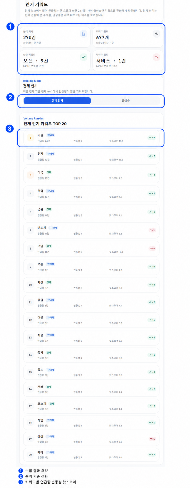
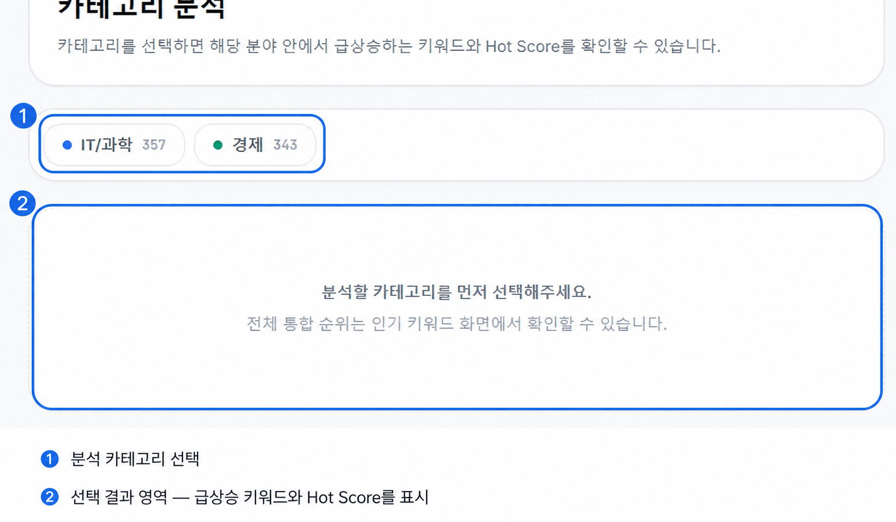
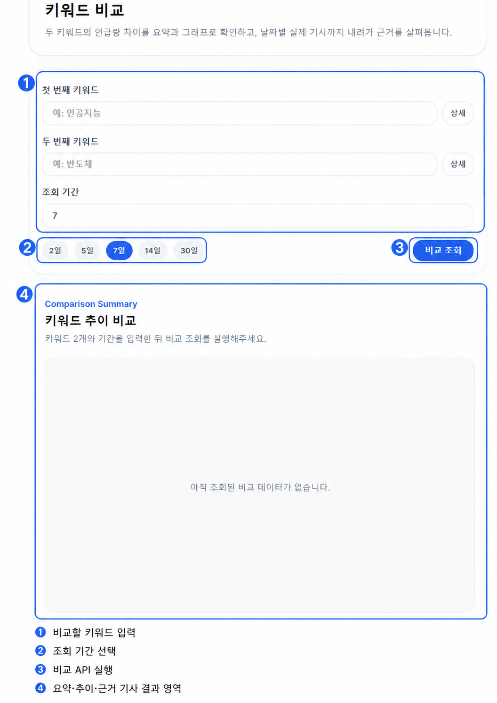
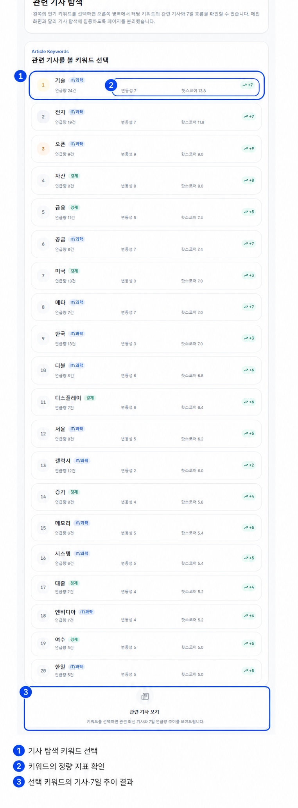
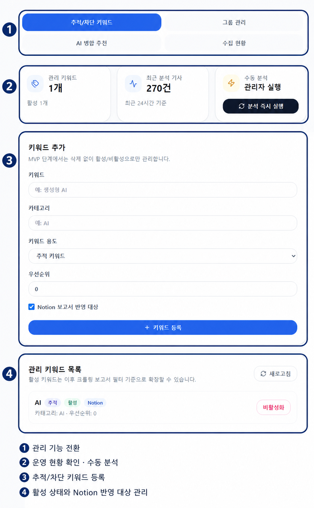

# 화면 안내

실제 OCI 배포 화면을 기준으로 기능과 데이터 흐름을 설명합니다. [라이브 서비스](https://shdomain.kro.kr)에서 직접 확인할 수 있으며, 화면의 순위·건수는 수집 시점에 따라 달라질 수 있습니다. 모든 이미지는 상단 계정 영역을 제외한 뒤, 마우스 커서 없이 촬영했습니다. 파란 원의 번호와 이미지 아래 범례를 함께 읽으면 각 기능의 입력·처리·결과를 빠르게 확인할 수 있습니다.

| 화면 | 라이브 주소 |
| --- | --- |
| 인기 키워드 | [대시보드](https://shdomain.kro.kr) |
| 카테고리 분석 | [카테고리](https://shdomain.kro.kr/categories) |
| 키워드 비교 | [비교](https://shdomain.kro.kr/history) |
| 관련 기사 탐색 | [기사](https://shdomain.kro.kr/articles) |

## 1. 인기 키워드

| 표시 | 기능 | 포트폴리오에서 보여 주는 점 |
| --- | --- | --- |
| ① | 최근 24시간 수집 요약 | 분석 기사 수, 추적 키워드 수, 상승·하락 키워드를 한 번에 보여 주어 수집 결과가 화면 지표로 이어짐을 확인한다. |
| ② | 순위 기준 전환 | `전체 인기`는 누적 언급량 중심, `급상승`은 최근 변동 중심으로 같은 수집 데이터의 두 관점을 전환한다. |
| ③ | 키워드별 정량 지표 | 순위·카테고리·`mentionCount`(언급량)·`velocityScore`(변동성)·`hotnessScore`(종합 점수)·증감을 함께 표시한다. |

- 사용자 흐름: 순위 기준 선택 → 관심 키워드 선택 → 키워드 상세 또는 관련 기사 탐색
- 주요 API: `GET /api/v1/trends/popular`, `GET /api/v1/trends/surging`

## 2. 카테고리 분석

| 표시 | 기능 | 포트폴리오에서 보여 주는 점 |
| --- | --- | --- |
| ① | 분석 카테고리 선택 | IT/과학·경제 등 카테고리별로 수집 범위를 좁힌다. 버튼의 숫자는 해당 분류의 집계 규모를 나타낸다. |
| ② | 선택 결과 영역 | 선택한 카테고리의 급상승 키워드와 Hot Score를 보여 주는 영역이다. 데이터가 없거나 선택 전에는 안내 상태를 명확히 표시한다. |

- 사용자 흐름: 카테고리 선택 → 변동성·상승/하락 키워드 확인 → 개별 키워드 탐색
- 주요 API: `GET /api/v1/trends/categories`, `GET /api/v1/trends/category`, `GET /api/v1/trends/stats`

## 3. 키워드 비교와 기사 근거

| 표시 | 기능 | 포트폴리오에서 보여 주는 점 |
| --- | --- | --- |
| ① | 비교 키워드 입력 | 두 키워드를 독립적으로 입력하고 각 키워드의 상세 화면으로도 이동할 수 있다. |
| ② | 조회 기간 선택 | 2·5·7·14·30일 빠른 선택과 직접 입력을 지원한다. |
| ③ | 비교 API 실행 | 지정한 두 키워드와 기간으로 시계열 비교를 요청한다. |
| ④ | 결과·근거 영역 | 누적 요약과 날짜별 추이를 보여 주고, 날짜를 선택하면 실제 기사 근거까지 내려가도록 설계된 영역이다. |

- 핵심 규칙: `Asia/Seoul` 달력 기준, 오늘은 부분 집계이며 완료된 날짜만 우세일 계산에 사용한다.
- 주요 API: `GET /api/v1/trends/history/compare`, `GET /api/v1/trends/history/evidence`

## 4. 관련 기사 탐색

| 표시 | 기능 | 포트폴리오에서 보여 주는 점 |
| --- | --- | --- |
| ① | 기사 탐색 키워드 선택 | 인기 키워드 목록에서 하나를 선택해 분석 대상을 정한다. |
| ② | 정량 지표 확인 | 선택 전에도 언급량·변동성·핫스코어·증감을 비교하여 탐색 우선순위를 정할 수 있다. |
| ③ | 기사·7일 추이 결과 | 선택한 키워드의 최신 기사와 7일 언급량 흐름을 표시하는 결과 영역이다. 원문 링크로 이동할 수 있다. |

- 주요 API: `GET /api/v1/trends/articles`, `GET /api/v1/trends/history`

## 5. 관리자 화면 (내부 운영 기능)

관리자 화면은 로그인 후 권한이 있는 사용자만 접근하는 내부 운영 기능입니다. 이 이미지는 계정 정보·비밀값 없이 구조만 촬영했으며, 실제 등록·비활성화·수동 분석은 실행하지 않았습니다.

| 표시 | 기능 | 운영 목적 |
| --- | --- | --- |
| ① | 관리 기능 전환 | 추적/차단 키워드, 그룹 관리, AI 병합 추천, 수집 현황을 탭으로 구분한다. |
| ② | 운영 현황·수동 분석 | 관리 키워드 수와 최근 분석 기사를 확인하고 필요할 때 분석을 수동 실행한다. |
| ③ | 추적/차단 키워드 등록 | 키워드·카테고리·용도·우선순위·Notion 반영 여부를 입력해 수집 기준을 관리한다. |
| ④ | 활성 상태 관리 | 삭제 대신 활성/비활성 상태로 관리해 수집 기준 변경 이력을 안전하게 다룬다. |

## 캡처 범위와 안전 기준

- 로그인·개인정보·Discord 연동 화면은 계정 정보가 노출될 수 있어 저장하지 않았다.
- 관리자 화면은 공개 기능의 증거가 아니라 내부 운영 구조의 설명용 이미지다.
- 화면 이미지에는 수집 시점에 따른 변동 데이터가 포함되므로, 수치 자체보다 지표·흐름·API 연결을 평가 대상으로 삼는다.
