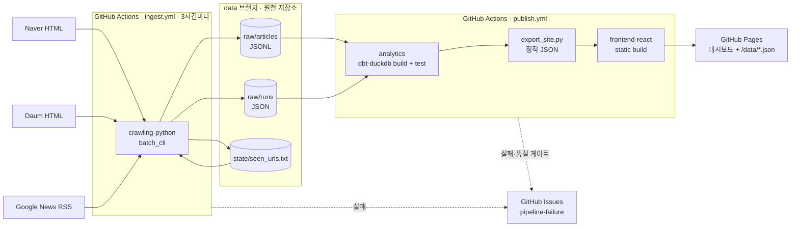

# Trend Analyzer v2 — 서버 없는 상시 운영 설계

> 상태: 설계 확정 전 초안 (2026-10-24) · 목표 완료일: 2026-11-05
> 관련 문서: [작업 분할](WORKSTREAMS.md) · [ADR](adr/) · [데이터 계약](../../contracts/)

## 1. 왜 v2인가

v1은 OCI VM 위에서 Python 수집기 · Spring Boot · Oracle · React를 Docker Compose로 운영했고, 지금은 중지 상태입니다. 포트폴리오를 보는 사람이 **지금 동작하는 결과물**을 확인할 수 없다는 것이 가장 큰 문제입니다.

v2의 목표는 다음 세 가지입니다.

1. **서버 비용 0원으로 상시 운영**: 수집·집계·배포를 GitHub Actions와 GitHub Pages만으로 수행합니다.
2. **v1과 같은 지표를 재현**: `mentionCount`, `velocityScore`, `hotnessScore`, 7~30일 추이, 근거 기사 계산식을 그대로 옮기고, 같은 입력에 같은 결과가 나오는지 테스트로 증명합니다.
3. **데이터 엔지니어링 역량을 드러내는 구조**: 원천 데이터 불변 저장, dbt 모델·테스트, 데이터 품질 게이트, 실행 이력 대사, 실패 알림을 갖춥니다.

v1 코드는 삭제하지 않습니다. 수집기(`crawling-python/`)와 화면(`frontend-react/`)은 v2에서 재사용하고, Spring·Oracle은 "v1 운영 구조"로 문서와 함께 보존합니다.

## 2. 전체 구조



| v1 구성요소 | v2 대체 | 비고 |
| --- | --- | --- |
| Python 수집기 + Flask 루프 | `crawling-python/batch_cli.py` 1회 실행 CLI | 크롤러·검증·선택·키워드 추출 코드는 그대로 재사용 |
| Spring 수집 API + Oracle `articles`/`article_keywords` | `data` 브랜치의 JSONL 원천 파일 | 불변 append-only, 실행 단위 파일 |
| `crawl_batch_runs`/`crawl_channel_runs` | `raw/runs/*.json` | v1 완료 보고 계약을 거의 그대로 사용 |
| Spring `TrendAnalysticService` (매시간) | dbt 모델 `fct_trend_snapshot` | 계산식 동일, 기준 시각은 `as_of` 변수 |
| Spring `TrendService` 조회 API | `export_site.py`가 미리 만든 정적 JSON | 응답 형태(DTO 필드명) 동일 |
| 관리자 alias 승인 | `analytics/seeds/keyword_aliases.csv` + PR 리뷰 | "AI는 후보만, 사람이 승인" 원칙 유지 |
| OCI VM 상시 실행 | GitHub Actions cron | 공개 저장소는 무료 |

## 3. 원천 저장: `data` 브랜치

- `main`과 히스토리를 공유하지 않는 orphan 브랜치 `data`에 원천 파일만 저장합니다.
- 수집 워크플로가 실행마다 파일을 **추가만** 합니다. 기존 파일은 수정하지 않습니다.
- 파일 경로의 날짜(`dt=`)는 배치 시작 시각의 **Asia/Seoul 날짜**입니다.

```text
data 브랜치
├── README.md                                  # 이 브랜치의 용도와 계약 링크
├── raw/
│   ├── articles/dt=2026-10-24/<run_id>.jsonl  # 기사 1건 = 1줄 (contracts/raw/article.schema.json)
│   └── runs/dt=2026-10-24/<run_id>.json       # 배치 1회 = 1파일 (contracts/raw/run.schema.json)
└── state/
    └── seen_urls.txt                          # 최근 7일 수집 URL (중복 수집 방지용, 매 실행 재생성)
```

**규모 추정**: 3시간마다 최대 50건 × 하루 8회 × 기사당 약 1KB → 하루 약 400KB, 1년 약 150MB. 1년 안에는 문제없고, 커지면 월 단위 Parquet 압축(compaction)을 추가합니다([ADR-0002](adr/0002-raw-storage-data-branch.md)).

**저작권·부하 원칙**: 본문 전체는 저장하지 않고 제목, 150자 요약, 원문 URL만 저장합니다(v1과 동일). 수집량과 주기도 v1과 같은 수준(3시간마다 최대 50건)을 유지합니다.

## 4. 수집: `crawling-python/batch_cli.py`

v1 `main.run_job()`에서 **전송 대상만 HTTP → 파일**로 바꾼 1회 실행 CLI입니다.

```bash
cd crawling-python
python batch_cli.py \
  --output-dir ../out \             # 여기에 raw/articles/..., raw/runs/... 를 만든다
  --seen-urls ../data/state/seen_urls.txt \  # 선택. 이미 수집한 URL은 선택 전에 제외
  --max-articles 50                 # 기본값 MAX_NEWS_PER_BATCH(50)
```

처리 순서는 v1과 같습니다.

1. 네이버·다음·RSS 채널을 각각 격리 실행합니다(`run_sources`).
2. `find_invalid_article_reason`으로 필수 필드를 검증합니다.
3. **(v2 추가)** `seen_urls.txt`에 있는 URL을 제외합니다. v1은 이미 저장된 기사도 50건 한도를 차지한 뒤 백엔드에서 버려졌기 때문에, 실제 신규 기사 수가 적었습니다(v1 README "현재 한계"의 `backendAcknowledgedCount` 문제). v2는 선택 전에 제외하므로 한도 50건을 신규 기사로 채웁니다.
4. `select_articles_fairly`로 채널×카테고리 순환 선택을 합니다.
5. KoNLPy 키워드 추출과 150자 요약을 만든 뒤 JSONL로 씁니다.
6. 실행 요약을 run JSON으로 씁니다. 수량 대사식은 아래와 같습니다.

```text
received      = validInput + validationRejected
validInput    = duplicateUrl + previouslySeen + eligible
eligible      = selected + droppedByLimit
selected      = preprocessingFailed + written + writeFailed
channelsTotal = success + partial + empty + failed 채널 수
```

종료 코드: `outcome`이 `FAILURE`이면 1, 그 외(`SUCCESS`·`PARTIAL_FAILURE`·`EMPTY`)는 0입니다. 부분 실패는 데이터를 저장하고 경고만 남깁니다.

## 5. 변환·품질: `analytics/` (dbt-duckdb)

```text
analytics/
├── dbt_project.yml / profiles.yml   # DuckDB 파일: target/trend.duckdb
├── seeds/
│   ├── keyword_aliases.csv          # alias, canonical_keyword, approved_at, note
│   └── blocked_keywords.csv         # keyword, reason
├── models/
│   ├── staging/      stg_articles, stg_article_keywords, stg_runs, stg_channel_runs
│   ├── intermediate/ int_article_keywords_canonical
│   └── marts/        fct_trend_snapshot, fct_keyword_daily, fct_dashboard_stats,
│                     dim_keyword, dim_category, fct_ingest_runs
├── tests/            # 단일 테스트(singular test): 수량 대사, 계산식, v1 동등성
└── export_site.py    # marts → site-data/*.json (contracts/site/*.schema.json)
```

입력 변수:

| 변수 | 의미 | 기본값 |
| --- | --- | --- |
| `RAW_DATA_DIR` (env) | `raw/`가 들어 있는 디렉터리 | `../fixtures/raw-root` |
| `as_of` (dbt var) | 지표 기준 시각, Asia/Seoul 로컬 `YYYY-MM-DDTHH:MM:SS` | 실행 시각 |

### 5.1 v1 지표 계산식 (동등성 대상)

| 지표 | 정의 (v1 원본 위치) |
| --- | --- |
| 기사 중복 제거 | `source_url` 기준, **가장 먼저 수집된 행**만 남김 (Oracle unique 제약 + 최초 insert 승리) |
| 대표 키워드 | 승인된 alias면 `canonical_keyword`, 아니면 원본 키워드 trim (`KeywordAliasCacheService.resolveKeyword`) |
| 차단 키워드 | 원본 또는 대표 키워드를 소문자·trim 비교해 차단 목록에 있으면 제외 (`TrendAnalysticService.resolveMetricKey`) |
| 집계 창 | current = `[as_of-24h, as_of)`, previous = `[as_of-48h, as_of-24h)`, `published_at`(서울 로컬) 기준 |
| `mentionCount` | current 창의 (기사 × 대표 키워드 × 카테고리) **고유 기사 수** |
| `velocityScore` | current 고유 기사 수 − previous 고유 기사 수 |
| `hotnessScore` | `mentionCount × 0.4 + velocityScore × 0.6` |
| 스냅샷 grain | 대표 키워드 × 카테고리. 두 창 모두 0건이면 행 없음 |
| 목록 API 병합 | 조회 시 같은 대표 키워드끼리 카테고리를 넘어 합산 (`TrendService.mergeAliases`) |
| 일별 추이 | 서울 날짜별, 대표 키워드에 속한 원본 키워드를 가진 기사 수와 `Σ(1 + 0.2 × (1 − 1/occurrence))` (소수 셋째 자리 반올림), 오늘은 `partial=true` |
| 대시보드 통계 | 최근 24시간 기사 수, 고유 원본 키워드 수, 최대 증가·감소 키워드 |

**v1 동작 중 바꾸는 한 가지**: v1 목록 API는 카테고리를 넘어 합산할 때 `category`에 "처음 만난 행"의 카테고리를 넣었습니다. 순서가 DB 정렬에 따라 달라져 결과가 흔들립니다. v2는 **`mentionCount`가 가장 큰 카테고리, 같으면 카테고리명 오름차순**으로 정해 결정적(deterministic)으로 만듭니다. 이 차이는 동등성 테스트에서 예외로 명시합니다.

### 5.2 품질 게이트

`dbt build`가 실패하면 배포하지 않고 직전 성공본을 유지합니다.

| 종류 | 검사 |
| --- | --- |
| 스키마 | `stg_articles.source_url` unique·not null, `category`·`channel`·`outcome` 허용값 |
| 관계 | `stg_article_keywords.source_url` → `stg_articles` |
| 대사 | run JSON의 `writtenCount` = 해당 run JSONL 줄 수 |
| 계산식 | `hotness = mention × 0.4 + velocity × 0.6` (오차 1e-6), `mention ≥ 0` |
| 신선도 | 최신 성공 run이 `as_of` 기준 6시간 이내 (경고), 24시간 초과 (실패) |
| 동등성 | v1 Java 테스트 케이스를 옮긴 고정 입력에서 기대값과 일치 |

## 6. 서빙: 정적 JSON + React static 모드

`export_site.py`가 Spring API 응답과 **같은 필드명**의 JSON을 미리 만들고, React는 `trendApi.js`의 구현만 바꿔 읽습니다. 페이지 컴포넌트는 수정하지 않는 것이 원칙입니다.

```text
<Pages 루트>/data/
├── meta.json                         # generatedAt, asOf, lastRunAt, freshness, counts
├── categories.json                   # [CategoryResponseDto + slug]
├── trends/all.json                   # GET /trends            (hotness Top20, alias 병합)
├── trends/category/<slug>.json       # GET /trends/category   (카테고리별 Top20)
├── trends/popular.json               # GET /trends/popular    (최대 50, 프론트에서 limit 자름)
├── trends/surging/all.json           # GET /trends/surging    (최대 50)
├── trends/surging/<slug>.json        # GET /trends/surging?categoryName=
├── stats/all.json, stats/<slug>.json # GET /trends/stats
├── keywords/index.json               # 대표 키워드 목록, alias→대표 매핑, slug
├── keywords/<slug>.json              # 30일 일별 추이 + 최신 기사 100건 + 날짜별 근거 기사 5건
└── runs/recent.json                  # 최근 50회 수집 실행 요약 (운영 현황 화면)
```

- 정확한 형태는 `contracts/site/*.schema.json`이 기준입니다.
- `slug`는 대표 키워드·카테고리 UTF-8 문자열의 SHA-256 앞 16자리 hex입니다. 프론트는 해시를 계산하지 않고 `index.json`·`categories.json`에서 찾습니다.
- 키워드 상세 파일은 최근 30일에 기사 2건 이상이거나, 현재 목록(Top20·급상승·인기)에 나온 대표 키워드만 만듭니다(최대 3,000개). 색인에 없는 키워드를 검색하면 "수집된 데이터가 없습니다"를 표시합니다. v1처럼 임의 키워드 전문 검색은 지원하지 않습니다([ADR-0004](adr/0004-static-json-serving.md)).
- `/history/compare`, `/history/evidence`는 두 키워드 파일을 받아 브라우저에서 계산합니다. 같은 대표 키워드 비교 거부, `days` 2~30, `limit` 1~5 등 v1 검증 규칙도 그대로 옮깁니다.
- static 모드에서 숨기는 기능: 로그인, 내 정보·구독, 관리자, Discord, 챗봇. 관리자 "수집 실행 이력"은 읽기 전용 **운영 현황** 화면으로 공개합니다.

빌드 변수: `REACT_APP_DATA_MODE=static`, `REACT_APP_STATIC_DATA_BASE=<Pages 경로>/data`, `PUBLIC_URL=/trend-analyzer-portfolio`.

## 7. 오케스트레이션: GitHub Actions

| 워크플로 | 트리거 | 하는 일 | 실패 시 |
| --- | --- | --- | --- |
| `ingest.yml` | cron `17 */3 * * *`, 수동 | `data` 브랜치 체크아웃 → `seen_urls` 생성 → `batch_cli` → 원천 파일 커밋·push(충돌 시 rebase 재시도 3회) | `pipeline-failure` Issue 생성·갱신 |
| `publish.yml` | ingest 성공 후(`workflow_run`), 매일 1회 cron, 수동 | dbt build → export → React static build → Pages 배포 | 배포 중단(직전 성공본 유지) + Issue |
| `ci-v2.yml` | PR, `claude/**` push | 수집기 pytest, dbt build(고정 데이터), 계약 검증, React test+build | PR 체크 실패 |

- 모든 job에 `timeout-minutes`와 `concurrency`를 둡니다. v1의 "장기 RUNNING 이력 자동 종료 없음" 한계는 실행 시간 상한으로 해소합니다.
- 실패 Issue는 같은 워크플로에 대해 열린 Issue 하나에 댓글로 누적하고, 다음 성공 시 자동으로 닫습니다.
- GitHub 예약 실행은 지연될 수 있습니다(수 분~수십 분). 신선도 기준을 6시간으로 둔 이유입니다.
- 공개 저장소의 예약 워크플로는 60일 동안 저장소 활동이 없으면 비활성화될 수 있습니다. 운영 현황 화면과 README 배지로 정지를 바로 알 수 있게 합니다.

## 8. 첫 데이터

v1 Oracle 데이터는 OCI 중지로 가져올 수 없습니다. 대신 Google News RSS 검색 피드가 `when:7d`(최근 7일)를 지원하므로, 첫 수동 실행에서 `--max-articles`를 키워 최근 7일치를 한 번에 채웁니다(backfill). 그러면 배포 첫날부터 7일 추이 화면이 의미 있게 보입니다.

## 9. 테스트 전략

| 층 | 무엇을 | 어디서 |
| --- | --- | --- |
| 수집기 단위 | 기존 47개 + 파일 sink, seen URL 제외, 대사식, 스키마 적합성 | `crawling-python/tests` |
| 기준 구현 | v1 Java 집계 로직을 Python으로 직역한 정답 계산기, 공용 고정 데이터의 정답 생성 | `fixtures/reference/v1_reference.py`, `fixtures/site/data` |
| 변환 | dbt 스키마·단일 테스트, 고정 입력 → 정답 JSON과 일치 | `analytics/tests`, `fixtures/raw-root` |
| v1 동등성 | Java `TrendAnalysticServiceTest`·`TrendServiceTest` 케이스를 옮긴 고정 입력 (Java 기대값 = 기준 구현 = dbt) | `analytics/tests/parity` |
| 계약 | 원천 파일·정적 JSON이 `contracts/**` JSON Schema를 만족 | `ci-v2.yml` |
| 화면 | 기존 52개 + static 어댑터 단위 테스트 | `frontend-react/src` |
| 운영 | 브랜치에서 `ingest`·`publish` 실제 1회 실행(뉴스 사이트 접근은 Actions에서만 가능) | GitHub Actions |

클라우드 개발 세션은 뉴스 사이트에 접속할 수 없습니다. 세션에서는 저장된 HTML·RSS 고정 데이터로만 검증하고, 실제 수집 확인은 Actions 실행 로그로 합니다.

## 10. 일정 (2026-10-24 ~ 11-05)

| 날짜 | 마일스톤 |
| --- | --- |
| 10/24 | 설계·계약·고정 데이터 확정 (이 문서) |
| 10/25–10/27 | 작업 A·B·C·D 병렬 진행, 각자 PR |
| 10/28 | **M1: 끝까지 한 번 흐르는 최소 구성**을 `main`에 병합 → 예약 실행 시작, backfill |
| 10/29–11/02 | 품질 게이트 강화, 운영 현황 화면, alias 제안 PR 봇(선택), 문서 |
| 11/03–11/05 | README v2, 설계 회고, 면접 예상 질문, 최종 점검 |

M1 이후부터 실제 데이터가 쌓이므로, 11/5에는 약 8일치 운영 데이터와 7일 backfill이 화면에 보입니다.

## 11. 하지 않는 것

- Kafka·Spark·클라우드 DW 도입: 데이터량(하루 약 400건)에 비해 과합니다. v1 결정과 같습니다.
- 로그인·구독·Discord: 서버가 필요하므로 v2 범위에서 제외하고 v1 구조로만 문서화합니다.
- 임의 키워드 전문 검색: 정적 서빙의 한계로 색인된 대표 키워드만 지원합니다.
