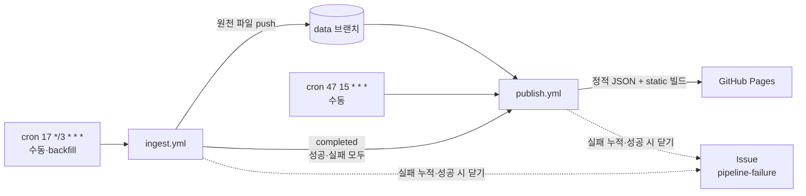

# v2 운영 런북

> 대상: `ingest.yml`·`publish.yml`·`ci-v2.yml`과 `scripts/ops/*`
> 관련 문서: [설계](DESIGN.md) 3절(원천 저장)·7절(오케스트레이션) · [작업 분할](WORKSTREAMS.md)

## 1. 한눈에 보기



| 워크플로 | 트리거 | 권한(job별 최소) | 하는 일 | 시간 상한 |
| --- | --- | --- | --- | --- |
| `ingest.yml` | cron `17 */3 * * *`(UTC, 서울 00:17·03:17…), 수동(`max_articles`, `trigger`=`workflow_dispatch`\|`backfill`) | ingest: `contents: write` · notify: `issues: write` | `data` 체크아웃 → `build_seen_urls.py` → `batch_cli.py` → `commit_raw.sh` | 30분(backfill 90분) |
| `publish.yml` | `workflow_run`(ingest completed, 성공·실패 모두), cron `47 15 * * *`(서울 00:47), 수동(`as_of`) | build: `contents: read` · deploy: `pages: write`, `id-token: write` · notify: `issues: write` | `build_pages.sh`(build_site → 계약 검증 → React static build) → Pages 배포 | 25분 + 10분 |
| `ci-v2.yml` | PR, `claude/**` push, 수동 | `contents: read`(ops job만 `issues: read` 추가) | 계약 검증, 운영 스크립트 테스트·lint, 수집기·analytics·프론트 테스트, 오프라인 e2e | job별 5~25분 |

공통
- 워크플로 최상위 `permissions: {}`(ingest·publish) 또는 `contents: read`(ci)로 시작하고, 필요한 job에만 권한을 더합니다.
- `concurrency`: `ingest`·`publish`는 그룹 하나에 `cancel-in-progress: false`(진행 중인 push·배포를 끊지 않음). `ci-v2`는 같은 ref의 이전 실행을 취소합니다.
- Python 3.12(pip 캐시), Java 21(KoNLPy, temurin), Node 20(npm 캐시).

`scripts/ops`

| 스크립트 | 역할 |
| --- | --- |
| `init_data_branch.sh [--dry-run]` | orphan `data` 브랜치(README, `raw/articles/`, `raw/runs/`, `state/`)를 만들어 push. 이미 있으면 아무것도 안 함. 작업 트리를 건드리지 않음 |
| `build_seen_urls.py --data-dir data` | 최근 7일(+경계 하루, `dt=` 기준 서울 날짜) URL → `state/seen_urls.txt` |
| `ingest.sh <data-dir>` | seen URL → `batch_cli.py` → `commit_raw.sh`. ingest.yml과 CI e2e가 같은 스크립트를 씀 |
| `commit_raw.sh <data-dir> <run-json>` | `raw/`·`state/` 커밋(`data: <runId> <outcome> written=<n>`) 후 push. 거부되면 rebase 후 최대 3회 재시도 |
| `build_pages.sh <raw-root> <out-dir>` | build_site → 계약 검증 → static build → `out/`(+`out/data/`). publish.yml과 CI e2e가 같이 씀 |
| `alert_issue.py failure\|success` | 워크플로별 `[pipeline-failure] <workflow>` Issue 하나에 실패 누적, 성공 시 닫기 |
| `compare_site.py <expected> <actual>` | 정적 JSON 두 벌을 값으로 비교(`generatedAt` 제외). CI에서 작업 B 정답 비교에 사용 |

## 2. 실패 처리 방식

| 상황 | 동작 |
| --- | --- |
| `batch_cli` outcome `FAILURE`(종료 코드 1) | run JSON은 **커밋해서 이력을 남기고** job 실패 → Issue |
| outcome `PARTIAL_FAILURE` | 수집분 저장, `::warning::`만 남기고 성공 처리(설계 4절) |
| outcome `EMPTY` | run JSON만 커밋, 성공 |
| `batch_cli`가 run JSON 없이 죽음 | 커밋하지 않고 실패 → Issue |
| push 거부(non-fast-forward) | fetch → `rebase -X theirs` → 재시도(최대 3회, 2·4·6초 간격). `raw/`는 runId별 새 파일이라 충돌하지 않고, 매번 다시 만드는 `state/seen_urls.txt`만 지금 올리는 쪽으로 해소 |
| 3회 재시도 후에도 push 실패 | job 실패 → Issue. 로컬 커밋은 러너와 함께 사라지지만 수집 대상 기사는 다음 실행에서 다시 수집됨(seen URL에 없으므로) |
| 시간 초과 | job 결과가 `failure` → Issue. v1의 "장기 RUNNING 방치" 문제를 상한으로 막음 |
| 사람이 취소 | 알리지 않음 |
| `build_site.py` 실패(dbt 테스트·계약 위반) 또는 static build 실패 | `upload-pages-artifact`·`deploy`가 실행되지 않음 → **직전 배포본 유지** → Issue |
| Pages 배포 실패 | Issue(`deploy=failure`) |
| 수집 실패 뒤 publish | 그래도 배포해서 `meta.json`의 `freshness`가 `stale`·`down`으로 바뀌게 함 |
| 같은 워크플로 연속 실패 | 열린 Issue 하나에 댓글로 누적(워크플로별로 Issue 분리) |
| 다음 성공 | 복구 댓글을 남기고 Issue를 `completed`로 닫음 |

## 3. 병합 전: 브랜치에서 확인하는 방법

예약 실행(`schedule`), `workflow_run`, `workflow_dispatch`는 워크플로 파일이 **기본 브랜치(main)에 있어야** 동작합니다. 그래서 병합 전에는 `claude/**` push로 도는 `ci-v2.yml`이 운영 경로를 대신 확인합니다.

| ci-v2 job | 확인하는 것 | 실행 조건 |
| --- | --- | --- |
| `ops` | `pytest scripts/ops`(git 원격은 로컬 bare 저장소, GitHub API는 가짜 transport, 수집기·build_site는 stub), `actionlint`, `shellcheck`, seen URL 생성, `alert_issue.py --dry-run`(실제 API로 열린 Issue를 **조회만**) | 항상 |
| `contracts` | 고정 데이터 계약 검증 | 항상 |
| `frontend` | `react-scripts test`, static build | 항상 |
| `collector` | `crawling-python` pytest | `crawling-python/requirements-batch.txt`가 있을 때 |
| `analytics` | `pytest analytics`, 고정 데이터 → 정답(`fixtures/site/data`)과 값 비교, 빈 raw-root에서 `freshness == down` | `analytics/build_site.py`가 있을 때 |
| `e2e` | **ingest·publish dry-run**: 가짜 원격에 `init_data_branch.sh`(두 번 실행해 멱등 확인) → `ingest.sh`(`--source-fixture`, 네트워크 없음) → 커밋된 원천 계약 검증 → `build_pages.sh` → 배포 디렉터리 확인 | `batch_cli.py`와 `build_site.py`가 모두 있을 때 |

건너뛴 job은 실패가 아니므로 A·B가 병합되기 전에도 ci-v2는 초록색입니다. job 조건에서는 `hashFiles`를 쓸 수 없어서 `detect` job이 체크아웃 후 `hashFiles(...)` 결과를 출력으로 넘깁니다.

로컬에서 같은 확인을 하려면

```bash
pip install pytest jsonschema actionlint-py shellcheck-py
pytest scripts/ops
actionlint
shellcheck scripts/ops/*.sh
python contracts/validate.py --raw-root fixtures/raw-root --site-dir fixtures/site/data

# 가짜 원격으로 ingest 한 번 (A 병합 전에는 stub 사용)
export DATA_REMOTE=/tmp/remote.git
git init -q --bare "$DATA_REMOTE" && bash scripts/ops/init_data_branch.sh && unset DATA_REMOTE
git clone -q -b data /tmp/remote.git /tmp/data
BATCH_CLI=scripts/ops/tests/stubs/batch_cli_stub.py bash scripts/ops/ingest.sh /tmp/data
```

뉴스 사이트 실제 수집과 Pages 배포는 병합 뒤 Actions에서만 확인할 수 있습니다(클라우드 개발 세션은 뉴스 사이트에 접속할 수 없음).

## 4. 병합 후 사람이 해야 하는 설정 (M1 체크리스트)

1. **Pages 소스 지정**: Settings → Pages → Build and deployment → Source를 **GitHub Actions**로. 이걸 안 하면 `deploy-pages`가 실패합니다.
2. **`github-pages` 환경**: 첫 배포 때 자동으로 생깁니다. Settings → Environments → github-pages의 배포 브랜치 규칙이 `main`을 허용하는지 확인합니다(기본값은 기본 브랜치만 허용).
3. **Actions 허용**: Settings → Actions → General에서 Actions가 켜져 있고, 사용할 액션(`actions/*`)이 허용돼 있는지 확인합니다. 워크플로가 권한을 job별로 선언하므로 "Workflow permissions" 기본값은 read로 둬도 됩니다.
4. **`data` 브랜치 만들기**(한 번만, 통합 담당)
   ```bash
   git fetch origin && bash scripts/ops/init_data_branch.sh --dry-run   # 만들 내용 확인
   bash scripts/ops/init_data_branch.sh
   ```
   브랜치 보호 규칙·ruleset이 모든 브랜치에 걸려 있다면 `data`는 제외하거나 `github-actions[bot]` push를 허용해야 합니다(PR 필수·서명 필수면 push 실패).
5. **첫 수집(backfill)**: Actions → ingest → Run workflow → `trigger=backfill`, `max_articles=400` 정도. 끝나면 `publish`가 자동으로 실행됩니다.
6. **배포 확인**: `https://toxh13.github.io/trend-analyzer-portfolio/`, `.../data/meta.json`의 `freshness`가 `ok`인지.
7. **README 배지 추가**(아래 7절).
8. **알림 받기**: 저장소 Watch → Custom → Issues를 켜면 `pipeline-failure` Issue가 메일로 옵니다. 라벨은 첫 실패 때 자동으로 만들어집니다.

## 5. 장애 대응 절차

1. `pipeline-failure` Issue의 실행 링크로 들어가 실패한 step을 확인합니다. 같은 Issue에 댓글이 여러 개면 언제부터 실패했는지 봅니다.
2. 원인별 조치

| 증상 | 원인 후보 | 조치 |
| --- | --- | --- |
| `data 브랜치 체크아웃` 실패 | `data` 브랜치 없음·이름 변경 | 4절 4번 실행 |
| `push 실패: 3회 재시도 후 포기` | 보호 규칙, 권한, 동시 push 폭주 | 보호 규칙 확인(4절 4번), 다음 예약 실행 결과 확인 |
| outcome `FAILURE`, 채널 전부 실패 | 뉴스 사이트 구조 변경·차단 | 로그의 채널별 오류 확인 → 작업 A 범위(크롤러 선택자) 수정 PR |
| KoNLPy/JPype 오류 | Java 설정 | `setup-java` 단계와 `requirements-batch.txt` 버전 확인 |
| `build_site` 실패 | dbt 품질 게이트(대사·계산식·스키마) 위반 | 실패한 dbt 테스트 이름으로 원천 run을 찾음. 잘못된 원천 파일은 **수정하지 않고** `data` 브랜치에서 해당 커밋을 `git revert`(append-only 원칙, 히스토리 재작성 금지) |
| 계약 위반(`contracts/validate.py`) | 생산자·스키마 불일치 | 해당 작업 PR에서 "계약 변경" 절차로 수정 |
| `deploy-pages` 실패 | Pages 소스 미설정, 환경 규칙 | 4절 1·2번 |
| freshness `stale`·`down`인데 Issue 없음 | 예약 실행 지연·비활성화 | 6절 |

3. 고친 뒤 Actions → 해당 워크플로 → Run workflow로 수동 실행합니다. 성공하면 Issue가 자동으로 닫힙니다.
4. 원인과 조치를 Issue 마지막 댓글에 한 줄로 남깁니다(회고·면접 자료).

수동 재배포만 필요하면 publish를 수동 실행합니다. 특정 시점 기준으로 다시 만들려면 `as_of`(서울 `YYYY-MM-DDTHH:MM:SS`)를 넣습니다.

## 6. 예약 실행 지연·60일 비활성화 대비

- GitHub 예약 실행은 수 분~수십 분 늦거나 건너뛸 수 있습니다. 신선도 `ok` 기준을 6시간(수집 주기 3시간의 두 배)으로 둔 이유입니다.
- 공개 저장소의 예약 워크플로는 **60일 동안 저장소 활동이 없으면 자동으로 비활성화**됩니다. 봇이 `data` 브랜치에 올리는 커밋이 활동으로 인정되는지는 문서에 명시돼 있지 않으므로, 인정되지 않는다고 가정합니다.
  - 미리 막기: 60일 안에 `main`에 커밋이 하나라도 있으면 됩니다. 일정상 11/05 이후 활동이 없으면 **2027-01-04 전후**가 위험 구간입니다. GitHub가 비활성화 전에 저장소 소유자에게 메일을 보냅니다.
  - 알아채기: `publish`도 같이 멈추므로 `meta.json`이 갱신되지 않습니다. 화면의 운영 현황, README 배지의 마지막 갱신 시각, 워크플로 배지로 확인합니다.
  - 되살리기: Actions → ingest(·publish) → **Enable workflow**, 또는 `gh workflow enable ingest.yml && gh workflow enable publish.yml`. 그다음 ingest를 수동 실행합니다.

## 7. README 배지

```markdown
[](https://github.com/toxh13/trend-analyzer-portfolio/actions/workflows/ingest.yml)
[](https://github.com/toxh13/trend-analyzer-portfolio/actions/workflows/publish.yml)
[](https://github.com/toxh13/trend-analyzer-portfolio/actions/workflows/ci-v2.yml)
[](https://toxh13.github.io/trend-analyzer-portfolio/)
[](https://toxh13.github.io/trend-analyzer-portfolio/)
```

- 워크플로 배지는 기본 브랜치의 마지막 실행 결과를 보여 줍니다.
- freshness 배지는 Pages의 `data/meta.json`(`contracts/site/meta.schema.json`)을 shields.io가 읽습니다. 값은 `ok`·`stale`·`down`. shields.io dynamic 배지는 값에 따라 색을 바꿀 수 없어 색은 고정입니다. 첫 배포 전에는 배지가 오류로 보입니다.

## 8. 알려진 한계

- 병합 전에는 실제 예약 실행·Pages 배포·뉴스 사이트 수집을 확인할 수 없습니다. ci-v2 e2e가 같은 스크립트를 가짜 원격과 고정 기사로 돌리는 것이 최선입니다.
- `publish`가 `analytics/requirements.txt`를 설치한다고 가정합니다. 작업 B가 다른 이름을 쓰면 `publish.yml`·`ci-v2.yml`의 설치 줄을 맞춰야 합니다. 수집기는 `requirements-batch.txt`(+있으면 `requirements-dev.txt`)를 설치합니다.
- e2e는 `crawling-python/tests/fixtures/*source*.json` 중 첫 파일을 `--source-fixture`로 씁니다(WORKSTREAMS A 완료 기준). 이름이 다르면 e2e가 오류로 알려 줍니다.
- `state/seen_urls.txt`가 rebase에서 겹치면 지금 올리는 쪽을 택하므로, 동시에 돈 다른 실행의 URL 일부가 빠질 수 있습니다. 다음 실행에서 원천 파일로 다시 만들고, 중복 기사는 dbt 단계에서 제거되므로 지표에는 영향이 없습니다.
- 실패 알림은 GitHub Issue뿐입니다(Slack·Discord 없음). 알림 job 자체가 실패하면(토큰 권한 등) 실행 화면의 빨간 표시로만 알 수 있습니다.
- 수집 원천은 `data` 브랜치에 계속 쌓입니다(설계 3절 추정 연 150MB). 압축(compaction)은 아직 없습니다.
